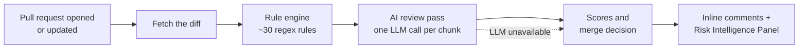

# PrivGuard Nexus

> **An AI code reviewer for pull requests and pushes.** PrivGuard Nexus is a GitHub Action that checks every change for privacy leaks, security risks, hidden backdoors, prompt injection and risky code, then posts inline comments on the exact lines plus a Risk Intelligence Panel with a merge decision.

🏆 **2nd Prize, Spyhacks Hackathon 2026**

It combines a fast rule engine with an LLM reviewer: the rules catch known patterns instantly, and the AI confirms them, throws out false positives and finds the issues the rules miss.

---

## Features

- **Privacy compliance:** PII in logs, personal data sent to third parties, missing consent (GDPR / CCPA style checks).
- **Security risks:** SQL injection, insecure HTTP, weak auth, unsafe deserialization, exposed stack traces.
- **Insider threats:** hardcoded bypasses and secrets, remote code execution, obfuscated payloads, data exfiltration.
- **AI safety:** prompt-injection phrases and user input placed straight into LLM prompts.
- **AI review pass:** an LLM reads the diff, confirms or dismisses each rule flag, and reports new issues the rules don't cover.
- **Diff chunking:** large PRs are split into chunks that fit the model's context window.
- **Severity filter:** `min-severity` hides low-priority comments; scores still count everything.
- **Graceful fallback:** if the LLM is down or rate-limited, PrivGuard keeps the rule results and still posts a review.
- **Strict mode:** optionally fail the PR check when the decision isn't "Safe to Merge".
- **Works with any OpenAI-compatible API:** Google Gemini (free tier), OpenAI, Groq, OpenRouter, or a local Ollama for the CLI.

---

## Two ways it guards your repo

| | **Pull request mode** | **Push mode** |
|---|---|---|
| When | A PR is opened or updated | You push straight to `main` |
| What it reviews | Everything the PR changes | Everything that push changed |
| Where results go | Inline comments on the PR + Risk Panel | One comment on the pushed commit, with each finding linked to its line |
| Can it stop bad code? | Yes: strict mode blocks the merge | It warns: the commit gets a red ❌ and you fix it in a follow-up |

Both run the same pipeline (rules → AI review → scoring) and both report to the dashboard. When a pull request is merged, the resulting push is **skipped**, because it was already reviewed in the PR. Generated files (`dist/`, `build/`, lockfiles, minified files, images) are always skipped; add more with `ignore-paths`.

---

## How it works



1. **Fetch the diff:** reads only the lines the PR (or push) adds, through the GitHub API, skipping generated files.
2. **Rule engine:** about 30 regex rules scan every added line, instantly and for free.
3. **AI review pass:** the diff is split into chunks (`max-chunk-chars`). For each chunk, one LLM call returns strict JSON that (a) gives a verdict on every rule flag and (b) lists new issues with line, category, severity, reason and fix. Anything outside the PR's added lines, with invalid labels, or already flagged is discarded. The prompt treats code as untrusted, so text in a PR that tries to instruct the reviewer is reported, not followed.
4. **Scoring:** privacy, security, AI-safety and backdoor scores (0 to 100) and a decision: **Safe to Merge**, **Needs Review** or **Do Not Merge**.
5. **Feedback:** inline review comments (rule findings first, AI findings after) and a panel showing what each stage found.

If the LLM can't be reached after retries (5 s, 20 s, 45 s), that chunk keeps its rule-based results, so a review is always posted.

---

## Quick start

**1. Add your LLM key as a repository secret**

*Settings → Secrets and variables → Actions → New repository secret*, named `LLM_API_KEY`.
A free Google Gemini key from [Google AI Studio](https://aistudio.google.com/apikey) works.

**2. Add the workflow** at `.github/workflows/privguard.yml`:

```yaml
name: PrivGuard Nexus

on:
  pull_request:                 # review PRs before they're merged
    types: [opened, synchronize, reopened]
  push:                         # and direct pushes to main (optional)
    branches: [main]

jobs:
  review:
    name: AI Security Review
    runs-on: ubuntu-latest
    permissions:
      pull-requests: write # comment on pull requests
      contents: write      # comment on pushed commits (push mode)

    steps:
      - uses: actions/checkout@v5

      - name: Run PrivGuard Nexus
        uses: chinmayee41203/privguard-nexus@v1
        with:
          github-token: ${{ secrets.GITHUB_TOKEN }}
          llm-api-url: 'https://generativelanguage.googleapis.com/v1beta/openai'
          llm-api-key: ${{ secrets.LLM_API_KEY }}
          llm-model: 'gemini-2.5-flash'
          min-severity: 'MEDIUM'
          strict-mode: 'true'
```

Open a pull request (or push to `main`) and PrivGuard reviews it within a minute or two. Only want PR reviews? Remove the `push:` lines and use `contents: read`.

### Inputs

| Input | Required | Default | Description |
|---|---|---|---|
| `github-token` | Yes | | Use `${{ secrets.GITHUB_TOKEN }}` |
| `llm-api-url` | No | `''` | Base URL of an OpenAI-compatible API. Leave empty for rules only. |
| `llm-api-key` | No | `''` | API key for the LLM provider |
| `llm-model` | No | `llama3:8b` | Model name, e.g. `gemini-2.5-flash` |
| `min-severity` | No | `LOW` | Lowest severity that gets an inline comment: `LOW`, `MEDIUM`, `HIGH` or `CRITICAL`. Scores still count everything. |
| `max-chunk-chars` | No | `12000` | Maximum size of each diff chunk sent to the LLM |
| `ignore-paths` | No | `''` | Extra paths to skip, as globs separated by commas or new lines (e.g. `docs/**, *.md`). Generated files are always skipped. |
| `strict-mode` | No | `false` | If `true`, fails the check unless the decision is "Safe to Merge" |
| `dashboard-url` | No | `''` | URL of a PrivGuard Nexus dashboard to send each review to |
| `dashboard-token` | No | `''` | Secret token the dashboard expects (store it as a repository secret) |

### Outputs

| Output | Description |
|---|---|
| `decision` | `Safe to Merge`, `Needs Review` or `Do Not Merge` |
| `overall-score` | Overall risk score, 0 to 100 |

### Other providers

| Provider | `llm-api-url` | Example `llm-model` |
|---|---|---|
| Google Gemini | `https://generativelanguage.googleapis.com/v1beta/openai` | `gemini-2.5-flash` |
| OpenAI | `https://api.openai.com` | `gpt-4o-mini` |
| Groq | `https://api.groq.com/openai` | `llama-3.3-70b-versatile` |
| OpenRouter | `https://openrouter.ai/api` | any listed model |

---

## Dashboard

The [`dashboard/`](dashboard) folder is a Next.js + Prisma + Postgres app that collects every review the Action posts: decision, risk scores, the review pipeline (rule flags, AI-dismissed false positives, AI-found issues), a privacy-impact timeline and each finding with its evidence and fix. Saving a review requires a secret token; viewing is public. See [dashboard/README.md](dashboard/README.md) to deploy your own on Vercel with a free Neon database.

---

## Run it locally (CLI)

Scan a folder on your machine, optionally with a local [Ollama](https://ollama.com) model:

```bash
npm install
npm run scan -- path/to/your/code -o privguard-report.json
npm run scan -- path/to/your/code --llm --llm-model llama3:8b
```

The `test-projects/` folder contains deliberately vulnerable sample code to try it on.

---

## Releases

Versions are published by the [release workflow](.github/workflows/release.yml). Pushing a tag such as `v1.0.0` checks that the action bundle is built and up to date, creates a GitHub Release with notes, and moves the `v1` tag to it. Use `@v1` to get fixes automatically within version 1, or pin an exact version like `@v1.0.0`.

---

## Project structure

```
action.yml                  GitHub Action definition (inputs, outputs)
scanner/src/action.ts       Action entry point: PR mode, push mode and the shared review pipeline
scanner/src/ignore.ts       Generated-file skipping and ignore-paths
scanner/src/rules.ts        Rule engine
scanner/src/review.ts       AI review pass and diff chunking
scanner/src/llm.ts          LLM client (OpenAI-compatible and Ollama, retries)
scanner/src/scorer.ts       Risk scores and merge decision
scanner/src/github.ts       PR review comments and Risk Intelligence Panel
scanner/src/report.ts       Shared report format and dashboard upload
scanner/src/index.ts        Local CLI
scanner/dist/index.js       Bundled action (built with ncc)
dashboard/                  Next.js dashboard (Prisma + Postgres)
demo/                       (demo branch only) deliberately risky code for the showcase PR
```
